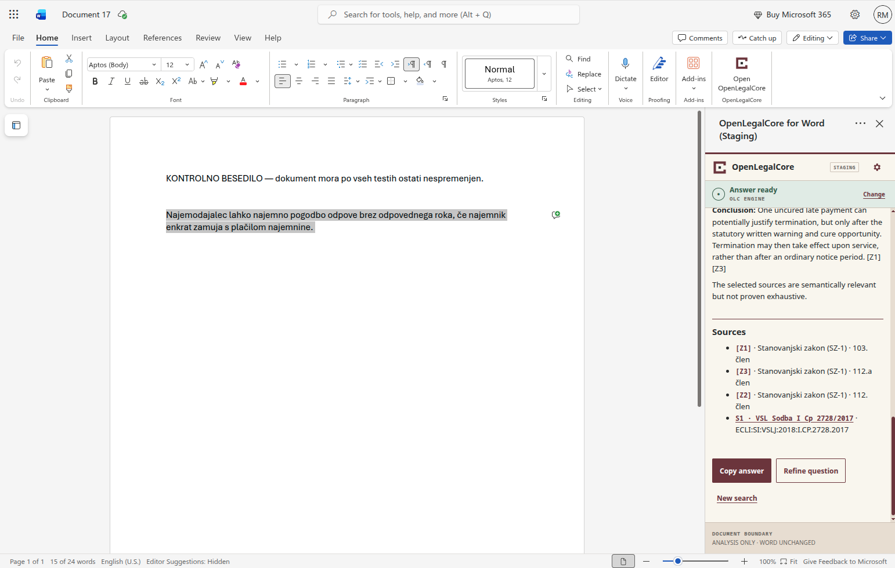
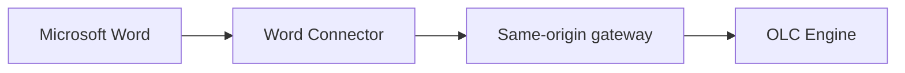

# OpenLegalCore Word Connector

**Verifiable Slovenian legal-source research, directly beside the text you are
reviewing in Microsoft Word.**

<p align="center">
  <a href="docs/assets/screenshots/v0.1/en-US/05-sources-and-actions.png">
    
  </a>
</p>

<p align="center"><sub>Click the preview to open the full-size screenshot.</sub></p>

OpenLegalCore Word Connector is an Apache-2.0 task-pane add-in for researching
Slovenian legislation and case law from Microsoft Word. The user asks a legal
question or instruction. The task pane automatically attaches only the current
Word selection when one exists, and receives an answer with source references
without changing the document.

> [!IMPORTANT]
> `v0.1.0-beta.1` is a source-only beta, not a hosted legal-research service.
> This repository does not include a public backend, legal database, AppSource
> listing, or access to OpenLegalCore's private infrastructure. Live searches
> require an operator-supplied compatible backend and secure same-origin
> gateway.

## Public record

|                              |                                                                                                 |
| ---------------------------- | ----------------------------------------------------------------------------------------------- |
| **Component status**         | Public source-only beta                                                                         |
| **Current release**          | [v0.1.0-beta.1](https://github.com/OpenLegalCore/olc-word-connector/releases/tag/v0.1.0-beta.1) |
| **Licence**                  | [Apache-2.0](LICENSE)                                                                           |
| **Project component record** | [OpenLegalCore Word Connector](https://openlegalcore.org/components/word-connector/)            |
| **Wider system map**         | [OpenLegalCore component register](https://openlegalcore.org/components/)                       |

## At a glance

[Current status and acceptance](docs/STATUS.md) distinguishes the public source-only
beta, later implemented candidates, attributed delivery and scoped owner results.
The documentation base is `fddc65d7ebf8a2f5e16332a322adca5783deacfd`.
Microsoft SSO reopen/idle has MANUAL PASS. The latest native document request
failed terminal validation; proposal display/Apply is not newly accepted.
Structured review and guarded writes exist in this candidate, but are not a
released editing promise. No new generation or live check occurred in this review.

Use [integration](docs/INTEGRATION.md) and [proposal safety](docs/WORD_DOCUMENT_PROPOSAL.md)
for the implementation, and the [documentation map](docs/DOCUMENTATION-MAP.md)
for historical release evidence/runbooks. OLC-74 remains open; SSO acceptance
must not be borrowed to declare proposal acceptance.

## Why this project exists

Legal research often means moving between a document, search tools, legislation
and case-law portals. This connector keeps that research step beside the text
being reviewed while making the boundary around document content explicit.

- **Legal professionals** can ask a question, inspect cited sources, copy an
  answer, refine the question or start again. Candidate document writes require
  a separate validated proposal and explicit Apply; the released beta claim is unchanged.
- **Developers** get a strict TypeScript codebase, provider-neutral controller,
  isolated Office.js boundary, hardened renderer and deterministic verification
  suite.
- **Partners and operators** can connect OLC Engine while
  retaining control over identity, hosting, credentials, legal corpora,
  retention and operational policy.

The connector supports research; it does not replace an authoritative legal
source or professional judgment. Retrieval coverage, historical validity and
answer quality depend on the configured backend and its data.

## How the workflow works

1. Open the task pane; it checks the protected OLC Engine connection automatically.
2. Optionally select text in Word and review or remove the compact **Selected text** attachment.
3. Enter a question or instruction and select **Send** (or press Enter).
4. Review the safely rendered answer and any `Z*` legislation or `S*` case-law
   references.
5. Use **Copy answer**, **Edit message** or **New message**.

OLC Engine SSE answers are rendered incrementally as untrusted text. Result
actions become available only after a valid completion terminal. **Edit message** preserves
the form for a new independent request; it does not continue a stored
conversation.

See the [English user guide](docs/USER_GUIDE.md),
[Slovenian user guide](docs/USER_GUIDE.sl-SI.md) and
[bilingual product gallery](docs/SCREENSHOTS.md) for the complete workflow.

## Document and trust boundary

- With no selection, the connector sends only the message.
- A valid Word selection appears automatically as a removable **Selected text**
  attachment. **Send** freezes the displayed attachment and interface language;
  the message and quoted selection remain separate fields.
- Receiving an answer leaves Word unchanged. The staging OLC-74 adapter offers
  separate validated proposal preview and guarded, user-clicked replacement/insertion;
  [proposal-only results are delivered on staging, with native Word qualification pending](docs/OLC74_ADAPTER_HANDOFF.md).
  Redlining and tracked-change management are not included.
- Cancellation, timeout, session expiry, backend failure and late responses
  leave the Word document unchanged.
- OLC Engine is the only backend. Requests are never retried automatically.
- Model output is untrusted text. Only credential-free HTTPS links on the exact
  approved PISRS and Slovenian case-law hosts can become clickable.

Read the [privacy statement](PRIVACY.md) and [security policy](SECURITY.md)
before evaluating the connector with a real document.

## Choose your starting point

| Goal                                | Start here                                                                             | What you need                                       |
| ----------------------------------- | -------------------------------------------------------------------------------------- | --------------------------------------------------- |
| Use the connector                   | [User guide](docs/USER_GUIDE.md) or [slovenski priročnik](docs/USER_GUIDE.sl-SI.md)    | Installed add-in and operator-provided access       |
| Browse the interface                | [Bilingual product gallery](docs/SCREENSHOTS.md)                                       | No installation                                     |
| Preview the UI locally              | [Local UI preview](docs/INSTALLATION.md#path-a-local-ui-preview)                       | Git and Node.js 24                                  |
| Load the add-in in Word for the web | [Word Web sideload](docs/INSTALLATION.md#path-b-word-for-the-web-development-sideload) | Microsoft 365, Git and Node.js 24                   |
| Connect OLC Engine                  | [Integration guide](docs/INTEGRATION.md)                                               | Compatible Engine and secure same-origin gateway    |
| Deploy a connected build            | [Connected deployment](docs/INSTALLATION.md#path-c-connected-self-hosted-deployment)   | HTTPS hosting, identity and operator infrastructure |
| Review or change the code           | [Technical guide](docs/TECHNICAL_GUIDE.md) and [contribution guide](CONTRIBUTING.md)   | Development environment                             |
| Evaluate support claims             | [Compatibility and limitations](docs/COMPATIBILITY_AND_LIMITATIONS.md)                 | No installation                                     |
| Understand future direction         | [Roadmap](ROADMAP.md)                                                                  | No installation                                     |

## Quick local UI preview

This path verifies that the project installs, builds and renders using
synthetic fixtures. It does not read Word or call a legal backend.

```bash
git clone https://github.com/OpenLegalCore/olc-word-connector.git
cd olc-word-connector
npm ci
npm run start:harness
```

Open `https://localhost:3002/harness.html`. If the local development
certificate is not trusted, follow the certificate step in
[Installation and deployment](docs/INSTALLATION.md); do not bypass a warning
for a non-local host.

## Architecture



The Office adapter owns Word access, the controller owns orchestration, the
Engine adapter owns the HTTP protocol and the view owns safe presentation.
Office proxy objects never enter the HTTP layer, and provider adapters never
mutate Word or the DOM.

The browser bundle accepts neither provider credentials nor private backend
origins. Production requests use same-origin routes with browser-session
credentials; the operator gateway keeps secrets and private-origin credentials
server-side.

See the [integration guide](docs/INTEGRATION.md) for the public backend and
gateway contract, and the [technical guide](docs/TECHNICAL_GUIDE.md) for the
internal runtime, transport, prompt, localization, manifest, build and test
contracts.

## Verification

The Word for the web release-gate walkthrough was accepted on 5 September 2026.
It covered the then-current two-provider release paths, both document-context modes, answer and source
rendering, result actions, cancellation with late-response suppression, secure
session recovery with an explicit retry, and an unchanged Word document.

The owner subsequently confirmed the Engine-only Word Web path with an answer,
sources and reported usage. On 23 October 2026 the owner accepted the simplified
Slovenian form in the actual local runtime harness: working logo, one heading,
automatic removable selection attachment and **Send**. That visual review did
not repeat a completion request; the broader simplified-form Word Web
walkthrough remains a separate pre-merge gate.

Windows and Mac remain untested and carry no support claim. Detailed evidence,
limitations and excluded capabilities are recorded in
[Compatibility and limitations](docs/COMPATIBILITY_AND_LIMITATIONS.md).

For a clean verification run:

```bash
npm ci
npm test -- --run
npm run typecheck
npm run lint
npm run validate
npm run build
npm run verify:bundle
```

The included CI workflow validates manifests and audits production dependencies
at high severity. `verify:bundle` rejects test, harness, fake, unsafe mutation,
credential-storage, service-token, private-origin and source-map artifacts from
the production bundle. Protected live tests are opt-in and are not part of
ordinary CI.

## Repository map

| Path                         | Responsibility                                                                      |
| ---------------------------- | ----------------------------------------------------------------------------------- |
| `src/app/`                   | Provider-neutral workflow, state and cancellation                                   |
| `src/office/`                | The only production boundary that uses Office.js                                    |
| `src/chat/`                  | OLC Engine protocol adapter and provider-neutral gateway contract                   |
| `src/taskpane/`              | Composition, localization, view models and safe rendering                           |
| `manifests/`                 | Development, staging and reserved production Office manifests                       |
| `infrastructure/cloudflare/` | Generic hardened same-origin gateway example                                        |
| `test/`                      | Deterministic unit, contract, manifest, harness and opt-in live tests               |
| `docs/`                      | Public user, installation, integration, technical, compatibility and release guides |
| `ROADMAP.md`                 | Current boundary, validation priorities and non-binding future directions           |

## Documentation

The [documentation index](docs/README.md) routes users, developers, operators,
reviewers and partners to the appropriate guide.

- [Installation and deployment](docs/INSTALLATION.md)
- [User guide](docs/USER_GUIDE.md)
- [Uporabniški priročnik](docs/USER_GUIDE.sl-SI.md)
- [Backend and gateway integration](docs/INTEGRATION.md)
- [Bilingual product gallery](docs/SCREENSHOTS.md)
- [Technical guide](docs/TECHNICAL_GUIDE.md)
- [Compatibility and limitations](docs/COMPATIBILITY_AND_LIMITATIONS.md)
- [Troubleshooting](docs/TROUBLESHOOTING.md)
- [Roadmap](ROADMAP.md)
- [Release policy](docs/RELEASE_POLICY.md)
- [Privacy](PRIVACY.md)
- [Security](SECURITY.md)
- [Contributing](CONTRIBUTING.md)

## License, contribution and collaboration

Copyright © 2026 Rajko Majcen.

Original OpenLegalCore code, documentation and assets in this repository are
licensed under the [Apache License 2.0](LICENSE), except for material identified
as third-party content. See [Third-party notices](THIRD_PARTY_NOTICES.md) and
[Trademarks](TRADEMARKS.md).

Read [CONTRIBUTING.md](CONTRIBUTING.md) before proposing a change. Never submit
client documents, selected text, generated legal answers, personal data or
credentials in an issue or pull request. Report suspected vulnerabilities
privately as described in [SECURITY.md](SECURITY.md).

For evaluation, integration, research collaboration or operated-service
discussions, see [Partnerships and services](PARTNERSHIPS.md). OpenLegalCore is
open to working with teams that want to evaluate or extend trustworthy legal-AI
workflows while retaining clear technical and data-governance boundaries.

The [OLC-74 correlated-capture source evidence](docs/evidence/olc74-correlated-capture/README.sl.md)
records the original preparation at fddc. Its later attributed diagnostic delivery
is distinguished in [current status](docs/STATUS.md); delivery is not a proven
incident fix or a new Word proposal/Apply acceptance.
