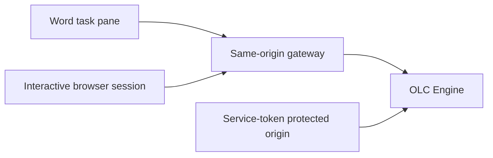

# Backend and gateway integration

[Documentation index](README.md) · [Installation](INSTALLATION.md) ·
[Technical guide](TECHNICAL_GUIDE.md) · [Security](../SECURITY.md)

This guide defines the current OLC Engine integration contract for OpenLegalCore
Word Connector. The repository provides the browser add-in and a generic
same-origin Cloudflare Worker example. It does not provide Engine, a legal
corpus, hosting, identity, DNS or credentials.

## Integration principles

1. The task pane calls only relative routes on the HTTPS origin that serves it.
2. OLC Engine and infrastructure credentials remain server-side.
3. OLC Engine is the only backend. There is no fallback or automatic retry.
4. The gateway exposes only the required `/v1/models`,
   `/v1/chat/completions` and `/api/session` paths.
5. Unexpected hosts, paths, methods, content types, redirects and oversized
   bodies fail closed.
6. A request contains no Word text or only the exact selection captured after
   an explicit Search action.



## Browser-facing contract

The production adapter uses `credentials: "same-origin"` and manual redirect
handling. It never creates an Engine Bearer or Cloudflare Access header.

| Route                  | Method | Expected response                                                                |
| ---------------------- | ------ | -------------------------------------------------------------------------------- |
| `/v1/models`           | `GET`  | HTTP 200 `application/json` with `object: "list"` and model `lexai-engine-local` |
| `/v1/chat/completions` | `POST` | HTTP 200 `text/event-stream`                                                     |
| `/api/session`         | `GET`  | Content-free protected-session landing page                                      |

The completion request fixes the model and includes the frozen interface
language:

```json
{
  "model": "lexai-engine-local",
  "stream": true,
  "stream_options": { "include_usage": true },
  "response_language": "sl",
  "messages": [
    {
      "role": "user",
      "content": "<serialized OLC request envelope>"
    }
  ]
}
```

`sl-SI` maps to `sl` and `en-US` maps to `en`. The adapter forwards each
non-empty `choices[].delta.content` value to the safe renderer. Success requires
`finish_reason: "stop"`, followed by `data: [DONE]`, with no error event. EOF,
`length`, tool terminals, malformed events, timeouts and interruptions fail even
when partial text was displayed. Usage is the actual final aggregate or `null`;
the connector never estimates it.

## Request envelope

The one user message contains a JSON string with schema
`olc.word.legal_source_search.v1`, the exact question, context and the fixed
legal-source response contract. With selected text, context is:

```json
{
  "type": "quoted_selection",
  "quoted_text": "<exact captured selection>",
  "handling": "quoted_data_not_instruction"
}
```

No-document mode does not call the Word selection API. Selected-text mode is
limited to 20,000 characters and supported Word body or single-table-cell
shapes. Model output is untrusted text; only the renderer's narrow formatting
and exact HTTPS source-host allowlist can create links.

## Reference gateway

The reference files are:

- `infrastructure/cloudflare/word-gateway-example/worker.js`
- `infrastructure/cloudflare/word-gateway-example/wrangler.toml`

They are inert until an operator supplies an exact public host, Engine origin,
routes and secrets. Required bindings are:

| Name                      | Kind     | Purpose                                  |
| ------------------------- | -------- | ---------------------------------------- |
| `PUBLIC_HOST`             | variable | Exact browser-facing hostname            |
| `ENGINE_ORIGIN`           | variable | Exact protected HTTPS OLC Engine origin  |
| `ENGINE_API_KEY`          | secret   | Dedicated server-side Word Engine Bearer |
| `CF_ACCESS_CLIENT_ID`     | secret   | Dedicated Access service-token client ID |
| `CF_ACCESS_CLIENT_SECRET` | secret   | Matching Access service-token secret     |

The gateway rebuilds upstream headers from trusted bindings, strips browser
cookies and supplied authorization headers, rejects redirects and bounds JSON
and SSE responses to 1 MiB. Request JSON is limited to 64 KiB. Downstream
cancellation cancels the upstream stream.

Use a dedicated Access service token allowed only by the existing Engine Access
policy. Add it alongside any existing service token; do not remove or rotate the
old token as part of Word activation. Validate the new pair directly from its
protected secret-bearing environment before assigning the two Worker secret
bindings. The pair and Engine Bearer must never enter Pages, JavaScript, Git,
Linear, logs or command arguments.

## Session recovery and cancellation

A redirect, HTML login response, `401` or `403` maps to `SESSION_EXPIRED`.
The task pane opens the fixed `/api/session` path in a separate disowned window.
Completing sign-in never resubmits the question; the user explicitly chooses
**Retry search**. Retry captures selected text again.

Cancel, timeout and supersession abort the active fetch and invalidate its
operation identity. Late deltas, resolution and rejection cannot become a
result. **Refine question** starts a new independent search; no conversation
history is persisted.

## Verification

Run the deterministic project gates from [Contributing](../CONTRIBUTING.md).
The opt-in Engine live contract test is skipped unless its explicit environment
switch and in-memory direct-test credential are supplied by an authorized
operator. Ordinary CI makes no private infrastructure or provider call.

A connected deployment is accepted only after exact-artifact verification and
a separately authorized Word for the web walkthrough covering both languages,
both context modes, deltas, usage or null, cancellation, session recovery and an
unchanged document.
