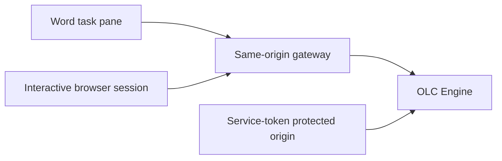

# Backend and gateway integration

[Documentation index](README.md) · [Installation](INSTALLATION.md) ·
[Technical guide](TECHNICAL_GUIDE.md) · [Security](../SECURITY.md)

This guide defines the current OLC Engine integration contract for OpenLegalCore
Word Connector. The repository provides the browser add-in and a generic
same-origin Cloudflare Worker example. It does not provide Engine, a legal
corpus, hosting, identity, DNS or credentials.

## Integration principles

1. The task pane calls only relative routes on the HTTPS origin that serves it.
2. OLC Engine and infrastructure credentials remain server-side.
3. OLC Engine is the only backend. There is no fallback or automatic retry.
4. The gateway exposes only the required `/v1/models`,
   `/v1/chat/completions` and `/api/session` paths.
5. Unexpected hosts, paths, methods, content types, redirects and oversized
   bodies fail closed.
6. A request contains no Word text or only the exact selection shown in the
   removable task-pane attachment and frozen by an explicit Send action.



## Browser-facing contract

The production adapter uses `credentials: "same-origin"` and manual redirect
handling. It never creates an Engine Bearer or Cloudflare Access header.

| Route                  | Method | Expected response                                                                |
| ---------------------- | ------ | -------------------------------------------------------------------------------- |
| `/v1/models`           | `GET`  | HTTP 200 `application/json` with `object: "list"` and model `lexai-engine-local` |
| `/v1/chat/completions` | `POST` | HTTP 200 `text/event-stream`                                                     |
| `/api/session`         | `GET`  | Content-free protected-session landing page                                      |

The local OLC-72 candidate fixes the model and selects the documented
`lexai_document_review_v1` profile (supported from Engine 9753ad1, not 09171ea).
The request fixes the frozen interface language:

```json
{
  "model": "lexai-engine-local",
  "stream": true,
  "stream_options": { "include_usage": true },
  "response_language": "sl",
  "messages": [
    {
      "role": "user",
      "content": [
        {"type": "text", "text": "<exact user instruction>"},
        {"type": "text", "text": "<exact frozen selection, omit this part when absent>"}
      ]
    }
  ]
}
```

The example above is abbreviated: **also include**
`response_format.type="json_schema"`, `json_schema.name="lexai_document_review_v1"`,
`strict=true` and the **full exact canonical schema**. The executable
`documentReviewBody`/`documentReviewSchema` in `src/chat/documentReview.ts` supplies
it. The pinned schema fingerprint and actual offline admission checks are in
[the proposal contract](WORD_DOCUMENT_PROPOSAL.md). A profile name alone or a
modified schema is invalid. No profile fallback is allowed.

`sl-SI` maps to `sl` and `en-US` maps to `en`. Content deltas are actual JSON
fragments; an incremental reader forwards only decoded `claims[].text` and
`notice` prefixes to the safe explanation renderer. Source/proposal fragments
never appear as explanation. Success requires
`finish_reason: "stop"`, followed by `data: [DONE]`, with no error event. EOF,
`length`, tool terminals, malformed events, timeouts and interruptions fail even
when partial text was displayed. Usage is the actual final aggregate or `null`;
the connector never estimates it. Only complete validated output can expose
separate sources or the explicit proposal. `NEEDS_CLARIFICATION`, `NOT_FOUND`
and `UNSUPPORTED` require empty claims/sources and `proposal:null` and cannot
enable document actions.

## Request parts and explicit document text

The one user message contains original text parts, not embedded JSON format
instructions. The first is the full unmodified instruction; the optional second
is the exact captured selection. No history, role/intent classifier or invented
context is added. The legacy `olc.word.legal_source_search.v1` envelope remains
only in the older direct/test compatibility path, not production composition.

With no valid attached selection, only the message is sent. The task pane
observes Word selection changes and displays a compact preview; moving focus
into the input preserves that preview. Selected text is limited to 20,000
characters and supported Word body or single-table-cell shapes. Model output is
untrusted text; only the renderer's narrow formatting
and exact HTTPS source-host allowlist can create links.

Claims/notice, source metadata and `proposal` remain separate. Document text is
the exact `proposal.markdown` string, previewed and inserted literally as plain
text; no citations, links, formatting markers or paragraphs are stripped. If
the public text restrictions fail, reject the result instead of repairing it.
Raw final JSON stays in current-result memory only. See
[document-write guards and the outstanding Engine incident](WORD_DOCUMENT_PROPOSAL.md).
This local adapter is not an activation or semantic-acceptance claim. The
existing login failure remains an unchanged production blocker.

## Reference gateway

The reference files are:

- `infrastructure/cloudflare/word-gateway-example/worker.js`
- `infrastructure/cloudflare/word-gateway-example/wrangler.toml`

They are inert until an operator supplies an exact public host, Engine origin,
routes and secrets. Required bindings are:

| Name                      | Kind     | Purpose                                  |
| ------------------------- | -------- | ---------------------------------------- |
| `PUBLIC_HOST`             | variable | Exact browser-facing hostname            |
| `ENGINE_ORIGIN`           | variable | Exact protected HTTPS OLC Engine origin  |
| `ENGINE_API_KEY`          | secret   | Dedicated server-side Word Engine Bearer |
| `CF_ACCESS_CLIENT_ID`     | secret   | Dedicated Access service-token client ID |
| `CF_ACCESS_CLIENT_SECRET` | secret   | Matching Access service-token secret     |

The gateway rebuilds upstream headers from trusted bindings, strips browser
cookies and supplied authorization headers, rejects redirects and bounds JSON
and SSE responses to 1 MiB. Request JSON is limited to 64 KiB. Downstream
cancellation cancels the upstream stream.

Use a dedicated Access service token allowed only by the existing Engine Access
policy. Add it alongside any existing service token; do not remove or rotate the
old token as part of Word activation. Validate the new pair directly from its
protected secret-bearing environment before assigning the two Worker secret
bindings. The pair and Engine Bearer must never enter Pages, JavaScript, Git,
Linear, logs or command arguments.

## Session recovery and cancellation

A redirect, HTML login response or `401` maps to legacy `SESSION_EXPIRED`
(**Access required**); this does not prove expiry. Non-HTML `403` is
`ACCESS_DENIED`. See the [Word Web recovery plan](WORD_WEB_ACCESS_RECOVERY.md)
for the required production identity/cookie qualification.
The local recovery candidate opens same-origin `signin.html` in an Office
dialog, then the fixed `/api/session` landing. The Worker example's exact-CSP
callback reports only a nonce-bound landing event. The pane checks the landing
and model discovery separately on explicit recovery; no completion is sent.
If the pane still cannot use the session, the user can explicitly request app
cookie access via Storage Access API. A grant does not authenticate, retry or
submit: another explicit connection check is required. Unsupported/denied grants
retain the message and explain the narrow managed-browser fallback. Word sandbox,
cookie/policy and real-browser qualification remain mandatory. This requires
matching future frontend/Worker delivery; no live change was made here.

Cancel, timeout and supersession abort the active fetch and invalidate its
operation identity. Late deltas, resolution and rejection cannot become a
result. **Edit message** starts a new independent request; no conversation
history is persisted.

## Verification

Run the deterministic project gates from [Contributing](../CONTRIBUTING.md).
The opt-in Engine live contract test is skipped unless its explicit environment
switch and in-memory direct-test credential are supplied by an authorized
operator. Ordinary CI makes no private infrastructure or provider call.

A connected deployment is accepted only after exact-artifact verification and
a separately authorized Word for the web walkthrough covering both languages,
message-only and attached-selection requests, deltas, usage or null,
cancellation and session recovery. Document writes additionally require the
separate native Word replacement/insertion, formatting, Undo/Redo and
Save/reopen matrix. Receiving a response must always leave the document unchanged.
