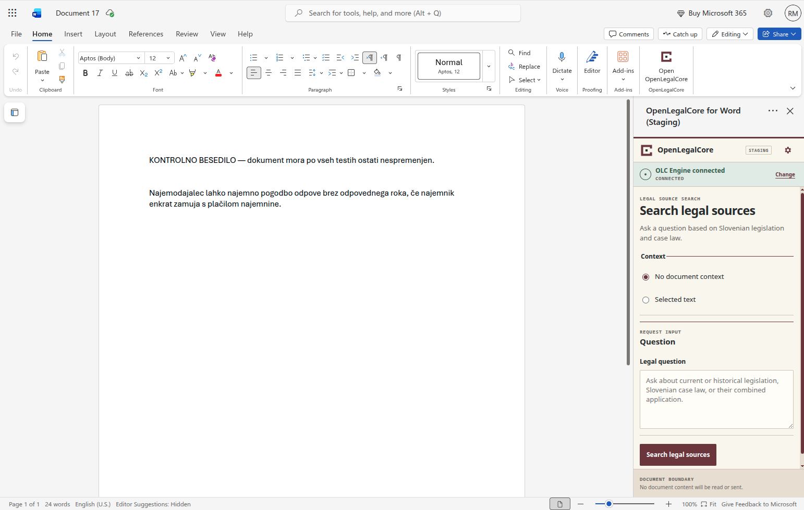
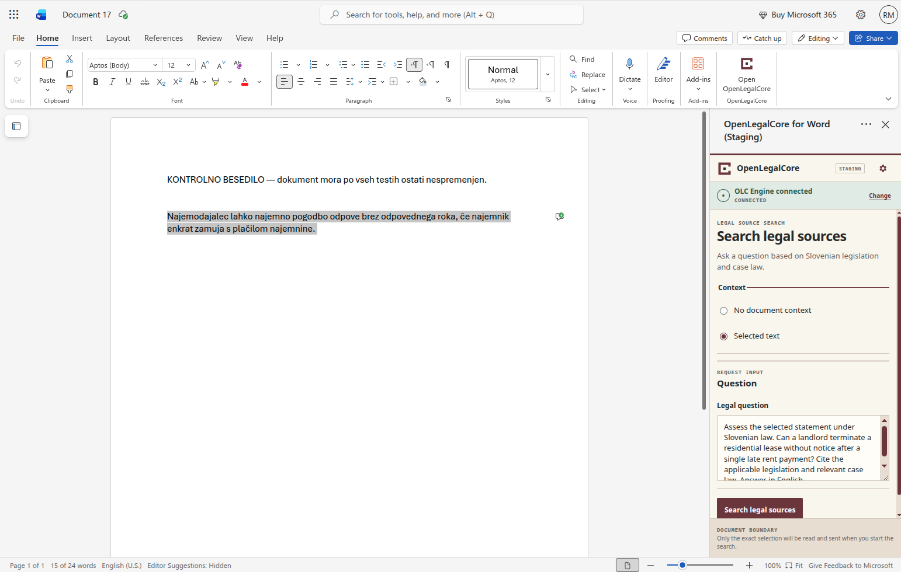
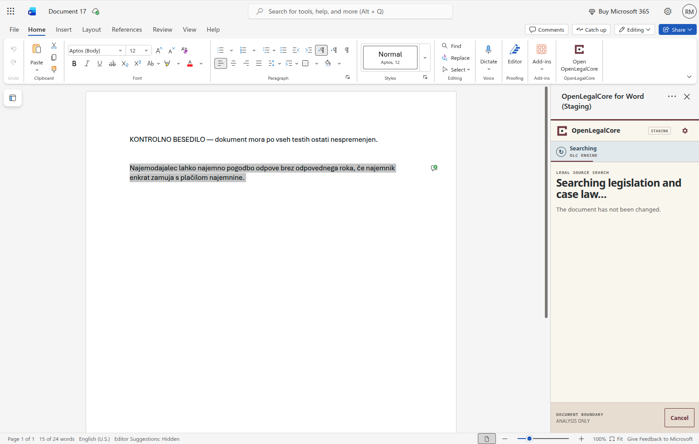

# User guide

[Slovenščina](USER_GUIDE.sl-SI.md) · [Product gallery](SCREENSHOTS.md) ·
[Installation](INSTALLATION.md) · [Troubleshooting](TROUBLESHOOTING.md)

OpenLegalCore Word Connector lets you ask a question or write an instruction
beside your document. It checks OLC Engine automatically and shows any selected
Word text as a removable attachment. Review the answer and any sources it
contains. Receiving an answer does not change the Word document. The current
deployed basic Engine path has no document proposal. The local OLC-72 candidate uses
Engine's documented document-review profile and previews
an explicitly supplied proposal separately, then offers **Replace selected
text** and **Insert at cursor** only after success and only on your click.
Replacement requires the unchanged original selection; insertion requires an
empty cursor. Each result permits one attempt; inspect Word before trying a new
request after an unconfirmed write. See [proposal status and qualification](WORD_DOCUMENT_PROPOSAL.md).

> [!IMPORTANT]
> The connector supports research; it is not an authoritative legal source and
> does not replace professional legal judgment. Verify every relevant law,
> historical version and court decision before relying on an answer.

## What you need

You need:

- Word for the web with the add-in installed or sideloaded;
- access to an operator-configured OLC Engine path;
- any browser sign-in required by that operator; and
- permission to submit the question and any selected text to that deployment.

This source repository does not include an AppSource installation, hosted
service, legal database or backend access. Developers and operators should
start with [Installation and deployment](INSTALLATION.md).

## The workflow at a glance

1. Open **Open OpenLegalCore** from the Word Home ribbon.
2. Wait while the task pane checks OLC Engine automatically.
3. If Word text is selected, review or remove the compact **Selected text** attachment.
4. Enter a question or instruction and select **Send**, or press Enter.
5. Verify the answer against its cited sources.
6. Copy the answer, edit the message or start a new message.

The connector supports English (`en-US`) and Slovenian (`sl-SI`). A fresh task
pane uses the supported Office display language, then the browser language,
then English. You can change the task-pane language in **Settings** for the
current runtime; the choice is not saved.

The interface language and answer language are separate. Ask in Slovenian for
a Slovenian answer or in English for an English answer. The connector does not
translate model output, citations, source text, URLs or copied content.

## 1. Open the task pane

1. Open the document you intend to use.
2. On the Word **Home** ribbon, select **Open OpenLegalCore**.
3. Wait for the task pane to report that the Word host is ready.
4. If the pane or ribbon command is missing, see
   [Troubleshooting](TROUBLESHOOTING.md#the-add-in-or-task-pane-does-not-open).

The screenshots in this guide were captured against private staging. The
visible `STAGING` label is intentional and does not imply that a public service
is included. Select a preview to open its full-size image.

## 2. Automatic OLC Engine connection

The connector checks the fixed `lexai-engine-local` model automatically when
the task pane opens, then shows the message input. It has no fallback backend,
does not send a message during this check and never retries automatically.

The ready form uses one **Ask OpenLegalCore** heading and an accessible message
input without repeated visible labels. The logo, selection attachment and
**Send** remain available in a narrow pane.

If the connection check fails, ask the deployment operator to verify the
same-origin `/v1/models` route, model and access policy.

## 3. Review the detected selection

With no valid Word selection, the connector sends no document content. Only the
message is sent.

  

Use this mode whenever the question stands on its own, for example:

> On 18 June 2021, what did Article 112 of the Housing Act (SZ-1) provide about
> the notice period and the court-ordered period to vacate? Identify the
> historical version used and cite the source.

### Selected text attachment

When the message concerns a precise passage:

1. Highlight only the relevant text in Word.
2. Confirm that the compact **Selected text** attachment shows the intended passage.
3. Remove the attachment if the passage should not be sent.
4. Enter the message and select **Send**.

The connector observes selection changes while the task pane is open. Moving
focus into the input preserves the displayed attachment. Send freezes the
displayed selection and interface language for that request. It sends selected
text as quoted data in a field separate from the message. It
does not add the rest of the document, surrounding paragraphs, document name,
file path or document metadata.

  

The search stops before contacting a provider if the selection is:

- empty or whitespace only;
- longer than 20,000 characters;
- spread across unsupported embedded structures; or
- a table selection other than ordinary text within one cell.

An invalid selection produces a visible warning and disables **Send** until the
selection is cleared or replaced with supported text. It is never silently
treated as an empty selection.

If Word selection changes after Send, the active request still uses the frozen
snapshot. A later independent request uses the attachment displayed for that
new request.

## 4. Ask a question or write an instruction

Include the jurisdiction, issue, legally relevant date and source type when
they matter. Ask for citations and invite the backend to state when evidence is
insufficient. A question can contain up to 4,000 characters.

### Legislation

> Explain the conditions for ordinary termination of a residential lease under
> SZ-1. Cite the relevant provisions and verify the currently applicable text.

### Slovenian case law

> Find Slovenian case law on terminating a residential lease because rent was
> paid late. Provide court names, case numbers and the core reasoning. If no
> reliable results are available, say so explicitly.

### Legislation and case law together

> Explain the statutory conditions for termination due to unpaid rent and
> examine how Slovenian courts interpret them. Separate legislation from case
> law.

### Historical law

> What was the wording of Article 112 of SZ-1 on 18 June 2021? Identify the
> historical version, later amendments and the source link.

Historical retrieval depends on the versions indexed by the selected backend.
The connector cannot guarantee complete temporal coverage.

## 5. Send or stop the request

Select **Send** once or press Enter. Shift+Enter inserts a line break; IME
composition does not submit. During an active request, the task pane shows
**Preparing response…** and makes **Stop** available.

  

Selecting **Stop** aborts the active request and returns the pane to a safe
state. A response arriving later cannot replace that state or appear as a
result. Cancellation, timeout and late responses leave the document unchanged.

While a valid OLC Engine streaming response is in progress, received answer
text appears incrementally through the same safe renderer used for completed
answers. Copy,
edit-message and new-message actions remain unavailable until the response ends with a
valid success terminal. A cancelled, interrupted or invalid partial response is
never promoted to a result.

## 6. Read the answer and sources

The answer renderer allows only a narrow formatting subset: headings, lists,
bold text, inline `Z*` and `S*` references, and approved HTTPS source links.
Raw model HTML is never executed.

- `Z1`, `Z2`, and similar references identify legislation sources.
- `S1`, `S2`, and similar references identify Slovenian case-law sources.

When the backend follows the response contract, the task pane presents a
separate **Sources** section. For OLC Engine results, the pane also shows the
token usage reported by the Engine, or states that usage is unavailable. It
does not estimate token counts.

  

Only credential-free HTTPS links on the connector's exact approved PISRS and
Slovenian case-law hosts become clickable. Malformed, unsafe, non-HTTPS,
lookalike or unapproved links remain text.

## 7. Verify before relying on a result

For every material proposition:

1. Open the cited authoritative source.
2. Confirm the act, article, court, case number and date.
3. Confirm that the source supports the proposition in the answer.
4. Check the version in force at the legally relevant time.
5. Review amendments, transitional provisions, later decisions and the factual
   or procedural context.
6. Apply independent professional judgment.

Semantic retrieval is not proven exhaustive. A missing result does not prove
that no relevant provision, version or decision exists. Coverage and answer
quality depend on the backend, model and indexed data.

## 8. Choose the next action

### Copy answer

Copies the answer to the system clipboard when the environment permits it. It
does not insert content into Word or change the document.

### Edit message

Returns to the form with the current message available for revision. The next
submission is a new independent request and uses the selection attachment then displayed.

### New message

Opens a clean form and clears the message. Any current valid Word selection is
shown separately as a removable attachment.

The basic Engine flow has no document-editing action. The local explicit
proposal candidate adds only the two guarded actions described above; it does
not add regeneration, redlining or tracked-change management.

## 9. Restore protected access

In the OLC-72 candidate, open **Settings → Check connection** to check access
without reloading the pane or sending your draft. It checks the protected session
landing, then the expected Engine model. Settings shows the latest result and its
time; it is not a promise that access will remain valid. A pending check disables
another check and Send while keeping typing and language selection available.
It retains the draft and attached or explicitly removed selection. If sign-in is
required, continue with the existing recovery below. No message is automatically
submitted after a check or sign-in. The new control still requires Word acceptance.

The current draft uses a short-lived Word session, independent of iframe
cookies. **Access required** means there is no usable Word capability; `403`
denial, network error, timeout and server failure remain distinct.

1. Select **Open secure sign-in**. Office may ask **Allow / Ignore**. Ignore
   cancels the dialog; it is not a policy denial.
2. Complete the operator's sign-in outside the pane. A current top-level login
   may avoid credential reentry where the identity provider permits.
3. The native Office callback exchanges a single-use PKCE-bound code for a
   memory-only Word session. Then only session/model GETs check the connection.
4. Review the retained message and selection attachment, then explicitly **Send**.
   No previous request is automatically submitted.

The session lasts at most 15 minutes. Recovery in an open pane retains the
multiline message, locale and attached/removed selection. Closing the pane
ends its in-memory state: copy a draft before closing; reopening requires a
new explicit sign-in gesture. There is no persistent draft or refresh token.
No Storage Access or browser cookie exception is required by this architecture.
Activation and actual Word qualification of this draft are still pending; see
[the architecture and evidence limits](WORD_SCOPED_SESSION.md).

The repository controls only its post-login confirmation page. The external
identity-provider or access page belongs to the deployment operator.

## Errors and safe failure

Connection failure, missing model, unavailable service, rate limit, timeout,
invalid or empty response, unsupported selection and clipboard failure do not
change the Word document.

When an error appears:

1. read the controlled message;
2. confirm the selected provider and document context;
3. correct the question or selection if indicated; and
4. retry only through an explicit user action.

Never work around a failure by placing provider credentials in frontend code,
disabling browser security controls or silently switching providers. See
[Troubleshooting](TROUBLESHOOTING.md).

## Privacy and confidentiality

When document text is unnecessary, remove the **Selected text** attachment or
send with no selection. When it is needed, submit the smallest relevant passage
and confirm that you are permitted to send it to the deployment.

The frontend does not persist provider credentials, questions, selections or
answers. Backend retention, logging, model processing and data location depend
on the operator. Read the [privacy statement](../PRIVACY.md) before using
personal, privileged or confidential material.

Do not place client documents, selected text, legal answers, credentials,
cookies or private host details in a public issue or support request.

## Verified scope and limitations

The historical Word for the web walkthrough on 5 September 2026 covered both
provider paths, both context modes, answer and source rendering, result
actions, cancellation with late-response suppression, session recovery through
secure sign-in and explicit retry, and an unchanged document. The owner also
accepted the Engine-only OLC-72 staging path with a rendered answer, sources,
reported usage and an unchanged document on the active candidate.

On 23 October 2026 the owner accepted the final simplified Slovenian appearance
in the actual local runtime harness. This records visual acceptance, not a new
completion test or the full simplified-form Word Web walkthrough.

Current boundaries:

- Word for the web is verified. Word for Windows and Mac are untested and have
  no support claim.
- The repository does not include a hosted service, backend, legal database or
  AppSource distribution.
- Whole-document and multi-document context are not included.
- Activation and native Word write qualification remain
  pending; redlining and tracked-change management are not included.
- Broader EU sources, literature and internal firm sources are roadmap items.
- The connector does not guarantee backend coverage or legal correctness.

See [Compatibility and limitations](COMPATIBILITY_AND_LIMITATIONS.md) for the
evidence matrix and [Product gallery](SCREENSHOTS.md) for all bilingual states.
