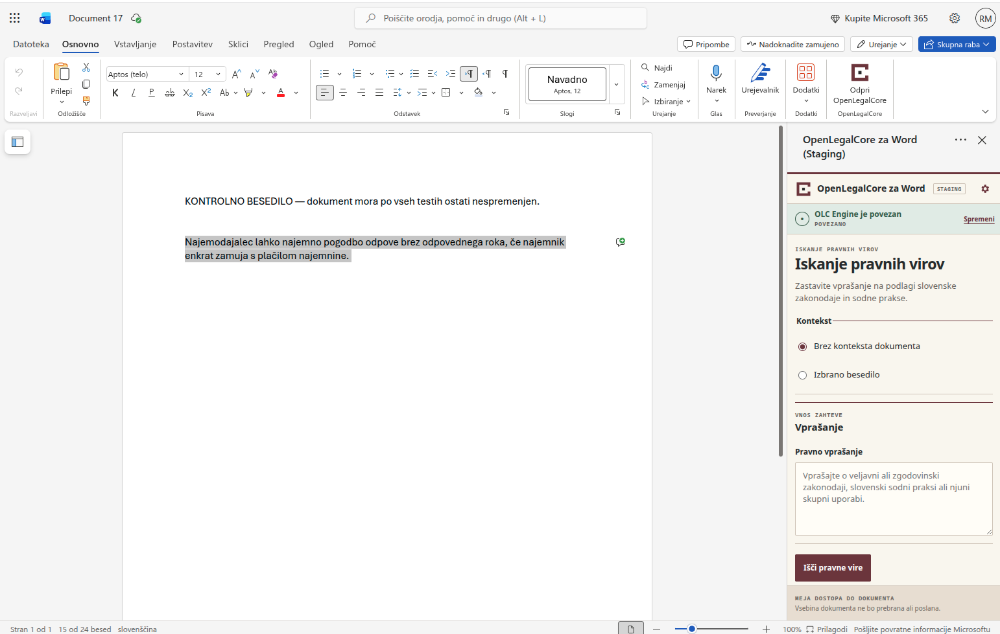
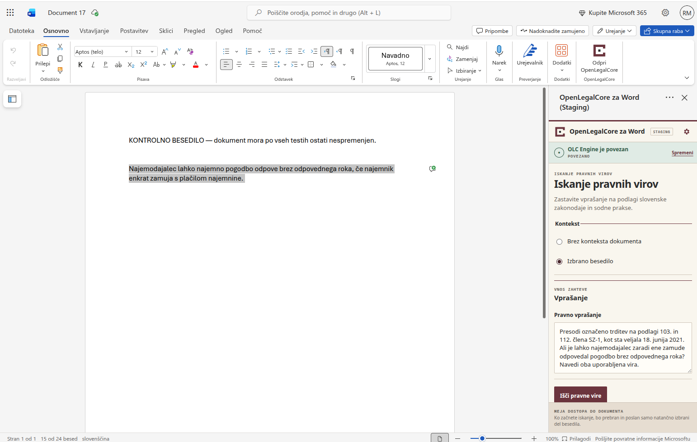
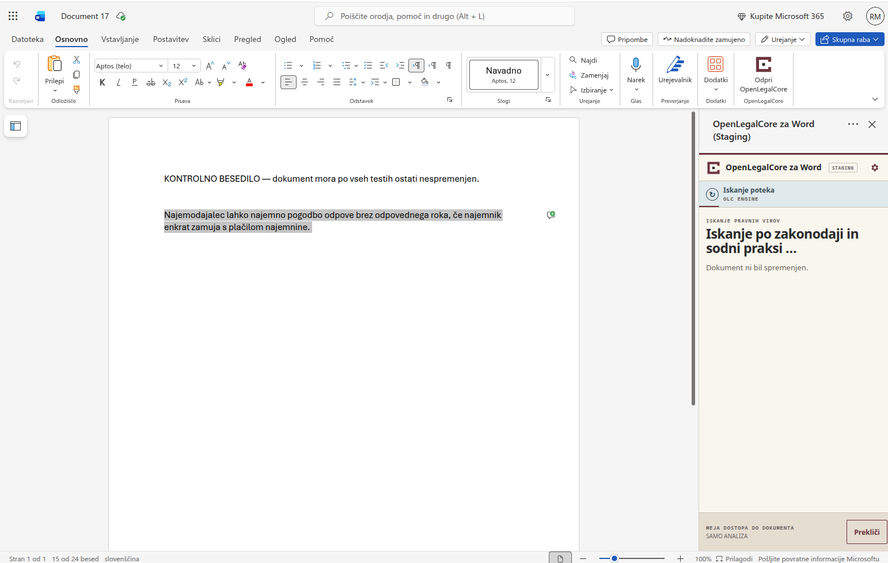
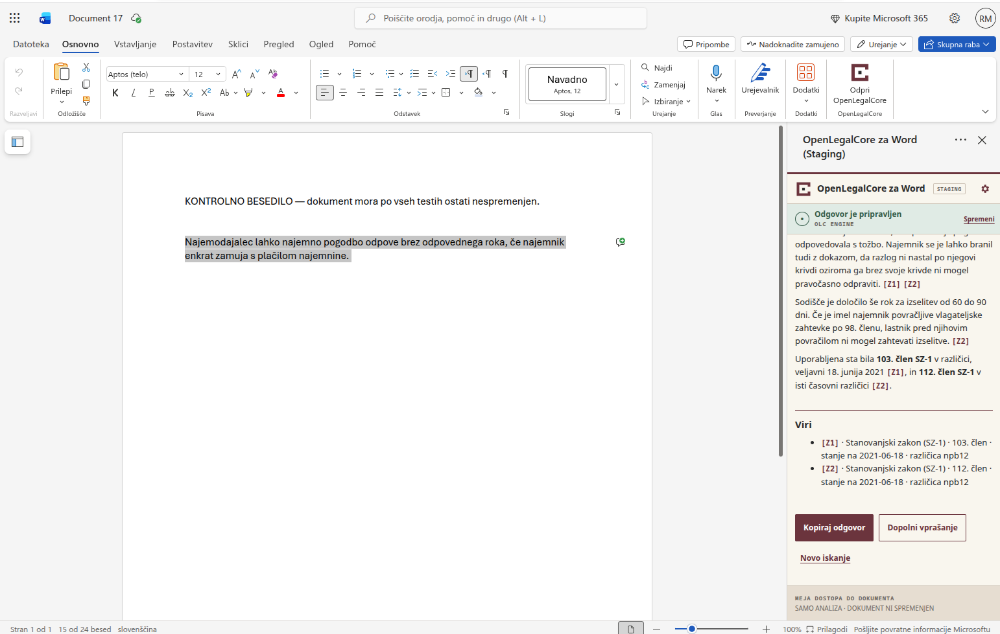

# Uporabniški priročnik

[English](USER_GUIDE.md) · [Galerija izdelka](SCREENSHOTS.md) ·
[Namestitev](INSTALLATION.md) · [Odpravljanje težav](TROUBLESHOOTING.md)

OpenLegalCore Word Connector omogoča, da ob dokumentu zastavite vprašanje ali
napišete navodilo. Samodejno preveri OLC Engine in morebitno izbrano Wordovo
besedilo prikaže kot odstranljivo priponko. Preglejte odgovor in vire, kadar jih
vsebuje. Prejem odgovora dokumenta ne spremeni. Trenutna osnovna Engine pot ne
vrača ločenega predloga. Lokalni kandidat OLC-72 uporablja dokumentirani
Engine document-review profil in posebej prikaže izrecno podan
predlog in šele po uspešnem odgovoru ponudi **Zamenjaj označeno besedilo** in
**Vstavi na mesto kazalca**. Zapis se izvede samo ob vašem kliku. Zamenjava
zahteva nespremenjen prvotni izbor; vstavljanje prazen kazalec. Posamezen
rezultat omogoča en poskus; ob nepotrjenem zapisu pred novo zahtevo preverite
dokument. [Aktivacija in preverjanje v pravem Wordu še čakata](WORD_DOCUMENT_PROPOSAL.md).

> [!IMPORTANT]
> Komponenta je namenjena podpori pri raziskovanju. Ni avtoritativen pravni vir
> in ne nadomešča strokovne pravne presoje. Pred uporabo odgovora preverite vsak
> pomemben predpis, zgodovinsko različico in sodno odločbo.

## Kaj potrebujete

Potrebujete:

- Word za splet z nameščenim ali stransko naloženim dodatkom;
- dostop do poti OLC Engine, ki jo je nastavil upravljavec;
- morebitno prijavo v brskalniku, ki jo zahteva upravljavec; in
- dovoljenje za pošiljanje vprašanja ter morebitnega izbranega besedila v to
  okolje.

Ta izvorni repozitorij ne vsebuje namestitve iz AppSource, gostovane storitve,
pravne zbirke ali dostopa do zaledja. Razvijalci in upravljavci naj začnejo z
dokumentom [Installation and deployment](INSTALLATION.md).

## Postopek na kratko

1. Na Wordovem traku **Osnovno** odprite **Open OpenLegalCore**.
2. Počakajte, da podokno samodejno preveri OLC Engine.
3. Če je besedilo v Wordu izbrano, preglejte ali odstranite priponko **Izbrano besedilo**.
4. Vnesite vprašanje ali navodilo in izberite **Pošlji** oziroma pritisnite Enter.
5. Odgovor preverite v navedenih virih.
6. Odgovor kopirajte, sporočilo uredite ali začnite novo sporočilo.

Komponenta podpira angleščino (`en-US`) in slovenščino (`sl-SI`). Ob svežem
zagonu najprej uporabi podprt prikazni jezik Officea, nato jezik brskalnika in
nazadnje angleščino. Jezik podokna lahko za trenutno izvajanje spremenite v
**Nastavitvah**; izbira se ne shrani.

Jezik vmesnika in jezik odgovora nista ista nastavitev. Za slovenski odgovor
zastavite vprašanje v slovenščini, za angleškega pa v angleščini. Komponenta ne
prevaja odgovora modela, citatov, besedila virov, spletnih naslovov ali kopirane
vsebine.

## 1. Odprite podokno

1. Odprite dokument, ki ga želite uporabiti.
2. Na Wordovem traku **Osnovno** izberite **Open OpenLegalCore**.
3. Počakajte, da podokno potrdi pripravljenost Worda.
4. Če podokna ali ukaza na traku ni, glejte
   [Odpravljanje težav](TROUBLESHOOTING.md#the-add-in-or-task-pane-does-not-open).

Posnetki v tem priročniku so bili narejeni v zasebnem staging okolju. Vidna
oznaka `STAGING` je namerna in ne pomeni, da repozitorij vključuje javno
storitev. S klikom na predogled odprete sliko v polni velikosti.

## 2. Samodejna povezava z OLC Engine

Komponenta ob odprtju podokna samodejno preveri fiksni model
`lexai-engine-local` in nato prikaže vnos. Nadomestnega ponudnika ni, preverjanje
ne pošlje sporočila in zahteva se nikoli ne ponovi samodejno.

Pripravljeni obrazec ima enoten naslov **Vprašajte OpenLegalCore** in dostopno
označen vnos brez podvojenih vidnih oznak. Logotip, priponka izbora in **Pošlji**
ostanejo dostopni tudi v ozkem podoknu.

Če preverjanje povezave ne uspe, upravljavca okolja prosite, naj preveri
same-origin pot `/v1/models`, model in pravilo dostopa.

## 3. Preglejte zaznani izbor

Če v Wordu ni veljavnega izbora, komponenta ne pošlje nobene vsebine dokumenta.
Pošlje samo sporočilo.

  

To možnost uporabite vedno, ko je vprašanje samostojno, na primer:

> Na dan 18. junija 2021 pojasni 112. člen Stanovanjskega zakona (SZ-1).
> Kolikšen je bil odpovedni rok in kakšen rok je moralo sodišče določiti za
> izselitev? Navedi uporabljeno zgodovinsko različico in citiraj vir.

### Priponka Izbrano besedilo

Ko se sporočilo nanaša na natančno določen odlomek:

1. V Wordu označite samo relevantno besedilo.
2. Preverite, da kompaktna priponka **Izbrano besedilo** kaže pravi odlomek.
3. Če odlomka ne želite poslati, priponko odstranite.
4. Vnesite sporočilo in izberite **Pošlji**.

Komponenta opazuje spremembe izbora, dokler je podokno odprto. Prehod fokusa v
vnos ohrani prikazano priponko. Pošlji za zahtevo zamrzne prikazani izbor in
jezik vmesnika. Besedilo pošlje kot citirane podatke v polju, ki je ločeno od
sporočila. Ne doda
preostanka dokumenta, okoliških odstavkov, imena dokumenta, poti do datoteke ali
metapodatkov dokumenta.

  

Iskanje se ustavi še pred klicem ponudnika, če je izbor:

- prazen ali vsebuje samo presledke;
- daljši od 20.000 znakov;
- razporejen čez nepodprte vdelane strukture; ali
- izbor tabele, ki ni navadno besedilo znotraj ene celice.

Neveljaven izbor prikaže opozorilo in onemogoči **Pošlji**, dokler ga ne
počistite ali nadomestite s podprtim besedilom. Komponenta ga nikoli tiho ne
obravnava kot prazen izbor.

Če se izbor v Wordu po pošiljanju spremeni, aktivna zahteva še vedno uporablja
zamrznjeni posnetek. Poznejša neodvisna zahteva uporabi priponko, prikazano za
novo zahtevo.

## 4. Zastavite vprašanje ali napišite navodilo

Kadar je pomembno, navedite jurisdikcijo, pravno vprašanje, pravno relevanten
datum in želeno vrsto vira. Zahtevajte navedbo virov in naj zaledje jasno pove,
kadar nima dovolj zanesljivih podatkov. Vprašanje lahko vsebuje do 4.000
znakov.

### Zakonodaja

> Pojasni pogoje za redno odpoved stanovanjske najemne pogodbe po SZ-1. Navedi
> relevantne člene in preveri trenutno veljavno besedilo.

### Slovenska sodna praksa

> Poišči slovensko sodno prakso o odpovedi stanovanjske najemne pogodbe zaradi
> zamude s plačilom najemnine. Navedi sodišča, opravilne številke in bistvene
> razloge. Če ni zanesljivih zadetkov, to jasno povej.

### Zakonodaja in sodna praksa skupaj

> Pojasni zakonske pogoje za odpoved zaradi neplačila najemnine in preveri, kako
> jih razlaga slovenska sodna praksa. Loči zakonodajne in sodne vire.

### Zgodovinsko stanje prava

> Kakšno je bilo besedilo 112. člena SZ-1 na dan 18. junija 2021? Navedi
> uporabljeno zgodovinsko različico, poznejše spremembe in povezavo do vira.

Zgodovinsko iskanje je odvisno od različic, ki jih je indeksiralo izbrano
zaledje. Komponenta ne more jamčiti popolne časovne pokritosti.

## 5. Pošljite ali ustavite zahtevo

Enkrat izberite **Pošlji** ali pritisnite Enter. Shift+Enter vstavi novo vrstico,
sestavljanje znakov z IME pa ne pošlje zahteve. Med aktivno zahtevo podokno
prikazuje **Pripravljam odgovor …** in ponudi **Ustavi**.

  

Z izbiro **Ustavi** prekinete aktivno zahtevo in podokno vrnete v varno
stanje. Odgovor, ki bi prispel pozneje, tega stanja ne more nadomestiti in se ne
more prikazati kot rezultat. Preklic, časovna omejitev in pozen odgovor pustijo
dokument nespremenjen.

Med veljavnim pretočnim odzivom OLC Engine se prejeto besedilo odgovora
sproti prikazuje z istim varnim prikazovalnikom kot dokončani odgovori. Dejanja za kopiranje,
urejanje sporočila in novo sporočilo ostanejo nedostopna, dokler se odziv ne
konča z veljavnim uspešnim zaključkom. Preklican, prekinjen ali neveljaven delni
odziv nikoli ne postane rezultat.

## 6. Preberite odgovor in vire

Prikaz odgovora dovoljuje le ozek nabor oblikovanja: naslove, sezname, krepko
besedilo, sklice `Z*` in `S*` v besedilu ter odobrene povezave HTTPS. Surovi HTML
modela se nikoli ne izvede.

- `Z1`, `Z2` in podobne oznake označujejo zakonodajne vire.
- `S1`, `S2` in podobne oznake označujejo vire slovenske sodne prakse.

Ko zaledje spoštuje pogodbo odgovora, podokno prikaže ločen razdelek **Viri**.
Pri rezultatih OLC Engine podokno prikaže tudi porabo žetonov, ki jo sporoči
Engine, ali pa navede, da poraba ni na voljo. Števila žetonov ne ocenjuje.

  

Klikljive postanejo samo povezave HTTPS brez poverilnic na natančno odobrene
gostitelje PISRS in slovenske sodne prakse. Neveljavne, nevarne, nešifrirane,
zavajajoče ali neodobrene povezave ostanejo navadno besedilo.

## 7. Rezultat preverite, preden se nanj zanesete

Za vsako pomembno trditev:

1. Odprite citirani avtoritativni vir.
2. Preverite predpis, člen, sodišče, opravilno številko in datum.
3. Preverite, ali vir res podpira trditev v odgovoru.
4. Preverite različico, ki je veljala v pravno relevantnem času.
5. Preglejte spremembe, prehodne določbe, poznejše odločbe ter dejanski in
   procesni kontekst.
6. Uporabite samostojno strokovno presojo.

Semantično iskanje ni dokazano izčrpno. Odsotnost zadetka ne dokazuje, da
relevantna določba, različica ali odločba ne obstaja. Pokritost in kakovost
odgovora sta odvisni od zaledja, modela in indeksiranih podatkov.

## 8. Izberite naslednje dejanje

### Kopiraj odgovor

Odgovor kopira v sistemsko odložišče, kadar okolje to dovoljuje. Vsebine ne
vstavi v Word in dokumenta ne spremeni.

### Uredi sporočilo

Vrne se na obrazec, kjer je trenutno sporočilo na voljo za spremembo. Naslednja
oddaja je nova neodvisna zahteva in uporabi takrat prikazano priponko izbora.

### Novo sporočilo

Odpre prazen obrazec in počisti sporočilo. Morebitni trenutni veljavni Wordov
izbor se prikaže ločeno kot odstranljiva priponka.

Osnovna Engine pot nima dejanja za spreminjanje dokumenta. Lokalni kandidat
izrecnega predloga dodaja samo zgoraj opisani varovani dejanji, ne ponovnega
ustvarjanja odgovora, redline ali upravljanja sledenja spremembam.

## 9. Obnovite zaščiteni dostop

V kandidatu OLC-72 odprite **Nastavitve → Preveri povezavo**. Preverjanje ne
naloži podokna znova in ne odda osnutka. Preveri zaščiteno prijavno stran in nato
pričakovani model Engine. Nastavitve pokažejo zadnji rezultat in čas preverjanja;
to ni zagotovilo trajne veljavnosti dostopa. Med preverjanjem sta ponovno
preverjanje in Pošlji onemogočena, tipkanje in izbira jezika pa ostaneta dostopna.
Osnutek ter pripeta ali izrecno odstranjena priponka so ohranjeni. Če je potrebna
prijava, nadaljujte po obstoječem toku spodaj. Preverjanje in prijava sporočila ne
oddata samodejno. Novi kontrolnik še potrebuje sprejem v dejanskem Wordu.

Če zaščitena zahteva potrebuje prijavo, komponenta prikaže **Potreben je dostop**,
namesto da bi preusmeritev ali prijavno stran prikazala kot odgovor. Potek seje
je samo eden od možnih vzrokov; enako se lahko pokažejo blokirani piškotki ali
prijavna preusmeritev. Zavrnjeni dostop z navadnim/JSON odzivom je prikazan ločeno.
Če se težava ponavlja, uporabite [načrt diagnostike](WORD_WEB_ACCESS_RECOVERY.md),
ne ponavljajte oddaje sporočila.

1. Izberite **Odpri varno prijavo**.
2. V pogovornem oknu Office dokončajte prijavo upravljavca. Preklic ohrani vaš vnos.
3. Povratna stran zapre okno ob sprejetem vezanem sporočilu. To še ne dokazuje,
   da Word podokno lahko uporablja sejo.
4. Vrnite se v Word.
5. Izrecno izberite **Preveri povezavo**, preglejte obrazec in nato **Pošlji**.

Komponenta zahteve nikoli ne ponovi samodejno in nima nadomestnega ponudnika.
Obnova prijave ne pošlje prejšnjega sporočila. Pred izrecno izbiro **Pošlji**
preglejte trenutno sporočilo in priponko izbora.

Če se prijavno okno vrne, podokno pa še potrebuje dostop, **Dovoli piškotke
aplikacije v podoknu** prek Storage Access API zahteva samo dostop do piškotkov
aplikacije. Po dovoljenju sami izberite **Preveri povezavo**; dovoljenje še ni
prijava. Ob nepodprtem ali zavrnjenem dostopu ohranite vnos in z upravljavcem
preverite ozko izjemo za domeni aplikacije in Access ekipe. Ne izklapljajte
zasebnosti brskalnika v celoti. Lokalni kandidat še potrebuje pravi Word Web sprejem.

Repozitorij nadzoruje samo potrditveno stran po prijavi. Zunanja stran
ponudnika identitete ali dostopa pripada upravljavcu okolja.

## Napake in varna ustavitev

Napaka povezave, manjkajoči model, nedosegljiva storitev, omejitev zahtev,
časovna omejitev, neveljaven ali prazen odgovor, nepodprt izbor in napaka
odložišča Wordovega dokumenta ne spremenijo.

Ko se prikaže napaka:

1. preberite nadzorovano sporočilo;
2. preverite izbranega ponudnika in kontekst dokumenta;
3. po potrebi popravite vprašanje ali izbor; in
4. ponovite samo z izrecnim dejanjem.

Napake ne zaobidite z dodajanjem poverilnic v kodo vmesnika, izklopom varnostnih
nadzorov brskalnika ali tihim preklopom ponudnika. Glejte
[Odpravljanje težav](TROUBLESHOOTING.md).

## Zasebnost in zaupnost

Ko besedilo dokumenta ni potrebno, odstranite priponko **Izbrano besedilo** ali
pošljite sporočilo brez izbora. Ko je potrebno, pošljite najmanjši relevantni
odlomek in preverite, ali ga smete poslati v okolje.

Vmesnik poverilnic ponudnika, vprašanj, izborov ali odgovorov ne zapisuje
trajno. Hramba v zaledju, beleženje, obdelava z modelom in lokacija podatkov so
odvisni od upravljavca. Pred uporabo osebnih, zaupnih ali privilegiranih
podatkov preberite [izjavo o zasebnosti](../PRIVACY.md).

V javno težavo ali zahtevo za podporo ne dodajajte dokumentov strank, izbranega
besedila, pravnih odgovorov, poverilnic, piškotkov ali zasebnih naslovov.

## Preverjeni obseg in omejitve

Zgodovinski preizkus v Wordu za splet 5. septembra 2026 je zajel obe poti
ponudnikov, oba načina konteksta, prikaz odgovora in virov, dejanja z rezultatom,
preklic z zadušitvijo poznega odgovora, obnovo seje z varno prijavo in izrecnim
ponovnim poskusom ter nespremenjen dokument. Lastnik je na aktivnem kandidatu
sprejel tudi Engine-only staging pot OLC-72 s prikazanim odgovorom, viri,
porabo in nespremenjenim dokumentom.

Lastnik je 23. oktobra 2026 sprejel končni poenostavljeni slovenski videz v
dejanskem lokalnem runtime harnessu. To je vizualni sprejem, ne nov preizkus
completion zahteve ali celoten sprejem poenostavljenega obrazca v Wordu za splet.

Trenutne meje:

- Preverjen je Word za splet. Word za Windows in Mac nista preizkušena in zanju
  ni navedbe o podpori.
- Repozitorij ne vsebuje gostovane storitve, zaledja, pravne zbirke ali
  distribucije prek AppSource.
- Kontekst celotnega dokumenta in več dokumentov ni vključen.
- Aktivacija ločenega predloga in preverjanje zapisa v pravem Wordu
  še čakata; redline in upravljanje sledenja spremembam nista vključena.
- Širši viri EU, literatura in interni viri organizacij so v načrtu prihodnjega
  razvoja.
- Komponenta ne jamči pokritosti zaledja ali pravne pravilnosti.

Za matriko dokazov glejte
[Compatibility and limitations](COMPATIBILITY_AND_LIMITATIONS.md), za vsa
dvojezična stanja pa [galerijo izdelka](SCREENSHOTS.md).
